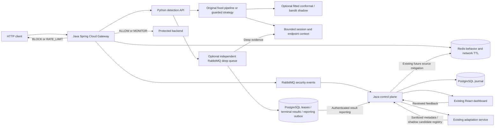

# Preserved architecture and research extension

The in-process deep worker remains the default/rollback adapter. The durable adapter is selected explicitly and uses a separate broker topology, not the security event queue. Flyway V6 adds metadata, PENDING/RUNNING/COMPLETED/FAILED/EXPIRED states, model pinning and leases. Raw request payloads remain only in broker messages; active queue TTL and v2 dead-letter TTL bound broker retention. A terminal DB result is retained until the authenticated reporter acknowledges it. This is at-least-once delivery with idempotent terminal processing, not exactly-once execution.

Gateway recovery covers only dependency operations; forwarding is outside Redis/inference timeout recovery. Bounded body buffering preserves raw supported bytes, query duplicates and encoding. Raw cookie inspection retains values rejected by a strict cookie parser. Unsupported compressed/binary/multipart bodies are rejected explicitly. Header/cookie canonicalization for detection does not rewrite the upstream bytes. Inspection coverage distinguishes full, partial, rules-only, unavailable and rejected outcomes.

The fixed model pipeline is executable unchanged. Guarded strategies prepend bounded semantic signatures, retain explicit deterministic evidence and cannot be overridden by an optional learned route. The signatures are not OWASP CRS and are not general protection. Static candidate routing reuses existing feature/expert/deep adapters; calibrated averaging is not a fitted fusion learner. Conformal artifacts must match the executed model and a separate reviewed calibration population. Bandit recommendations remain shadow-only; observed propensities describe tie randomization and cannot manufacture overlap for old deterministic logs.

HTTP and network inference have independent bounded execution pools. A deadline includes queue wait. Timed-out native calls retain slots until completion; permanently hung native execution still needs process isolation. Deep execution has a model-specific lock because CUDA OOM recovery moves that model to CPU. No global HTTP/network serialization is added. CUDA unavailability falls back to CPU; injected CUDA allocation failure tests the retry path without exhausting the user's GPU.

Session identity is an optional HMAC of an explicit session cookie, never an IP substitute. Bounded revisions preserve original decisions, deduplicate evidence, decay/expire, and allow reviewed corrections. Shadow mode records evidence; simulation mode can affect future decisions in controlled fixtures. Process-local context clears on restart and is not a distributed session database. Deferred evidence cannot reverse completed backend work. Endpoint artifacts contain aggregate structure from reviewed benign observations, freeze on export and load explicitly.

Input-risk drift requires an explicit reviewed reference. Calibration metrics require retained joined verified labels. The bounded lowest-confidence review queue cannot turn detector predictions into labels. The control-plane review journal and detection monitoring join are distinct; curated exports contain sanitized metadata, not a supervised payload dataset. Candidate training and runtime promotion are separate actions.

Runtime policy preparation loads a real candidate before recording SHADOW status. Promotion checks explicit flags, approval reference and empirical security/resource gates, then requires a runtime acknowledgement. Operational errors can roll back to an acknowledged previous pipeline. Append-only audit files survive restart, but startup uses configured baseline; candidate pointers are not automatically revived. Administrative model registry states are labeled separately from active inference versions.

Research UI reads actual detection telemetry and an explicitly selected report under research/runs. No mock counters or fictional learning curves are displayed. Successful inference RPS is distinct from full gateway throughput. GPU allocator observation is distinct from utilization; broad device utilization is sampled only by the benchmark. Internal write endpoints require WAF_INTERNAL_TOKEN; unset configuration denies them. TLS, separate service identities and full production authorization/exposure review remain outside this verified local checkpoint.

## Operator tool integration

Authenticated control-plane tool routes proxy only fixed internal detection/adaptation/gateway services. Browser replay templates preserve cookie/header evidence without browser-forbidden Cookie header injection. Every replay has a UUID joined with the immutable security journal. Read-only Redis tools use bounded SCAN sampling under waf:*; they do not expose general administration. Model Lab invokes actual model artifacts independently of rules. Offline routing fits retain population/source/model provenance and persistent shadow artifacts; no automatic activation path is added. Timing targets only the owned gateway, preserves enforcement, and distinguishes client latency/response throughput from observed inspection coverage. Gateway WebClients refresh service DNS within five seconds without retrying backend operations.
